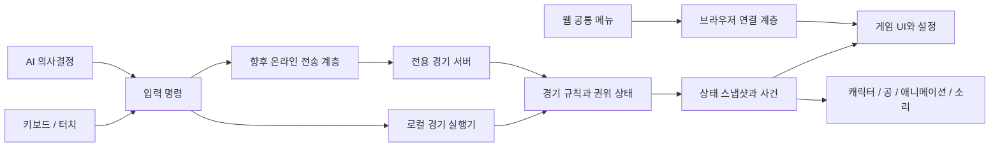

# 구현 구조와 전달 계획

## 2026-10-25 표시 리그의 전환 경계

기본 클립 → 몸통/시선 레이어 → 손·발 접촉 순서는 유지한다. `transition_pose()`는 팔다리의 마지막 접촉 자세를 보존하되 척추·목·머리·쇄골은 보정 전 자세로 넘겨 중복 적용을 피한다. 자유 달리기 발 속도 제한으로 실제 발과 목표 궤적에 차이가 생기므로, contact_mode 진입 때 진행 중인 발 회수 궤적을 실제 toe_world에서 다시 시작한다. 입력·이동 속도·공 판정 시간을 늦추지 않는다.

수비 도약 준비는 현재 root_height에서 시작하고, 리바운드 후 손 회수는 기존 공의 0.20초 전달 구간과 같은 진행도를 사용한다. 블록 타격 속도 일괄 제한은 실제 접촉을 놓치므로 적용하지 않는다. 웹 HUD는 원문 문자열을 WeakMap에 저장하고 변경 시에만 textContent를 쓴다. 번역된 DOM 문자열과 비교하지 않아 언어 변경 후 원문 재삽입을 피한다.

## v0.7.3 공통 오디오 경계

`scripts/court_audio.gd`가 Music2덱·Voice1플레이어와 Court/Music/Voice/SFX버스를 관리한다. game.gd는 실제 게임 이벤트를 cue로 전달하며 난수·득점·성장 규칙과 분리한다. 음성은 제작 시 로컬 합성한 WAV, 음악은 자체 합성 Vorbis로 패키지에 포함한다. 웹·향후 Android에서 같은 자산과 컨트롤러를 사용하고 런타임 외부 음성 API는 없다. 웹은 음악/해설 플레이어의 playback_type을 STREAM으로 지정해 기본 Sample의 종료/정지 수명 차이를 피한다.

셸은 기존 설정에 music/voice/track/musicDb/voiceDb/sfxDb를 검증해 추가하고 JSON 경계로 전달한다. 이전 sound/reduced는 보존한다. 음악 선택·다음 곡·음량은 게임 규칙을 변경하지 않으며 탭 이탈/메뉴에서는 음성과 오래된 대기를 지우고 음악 위치를 보존한다. 네이티브 앱 포커스 이탈도 정지한다. Android 실제 출력 지연·오디오 포커스·이어폰 해제 검증은 출시 전 별도 수행해야 한다.

작성일: 2026-10-23 / 상태: 목표 구조와 전달 계획. v0.1은 일부 시스템을 작은 모듈로 구현했으며, 실제 구현·측정 범위는 README와 04-prototype-validation.md를 따른다.

## 1. 구조

v0.1 실제 파일은 `game.gd`(로컬 경기 실행), `rules.gd`(판정 함수), `actor.gd`(절차적 캐릭터/포즈), `art.gd`(코트·메시·재질), `site/`(접근 가능한 웹 UI)로 나눴다. 아래 구조는 후속 리팩터링 목표다. 아직 CharacterBody3D, AnimationTree, 전용 서버가 적용되었다고 해석하지 않는다.

로컬 실행기와 온라인 전송은 모드별 대안이다. 한 경기에서 두 권위 상태를 동시에 실행하지 않는다. 경기 규칙은 화면·사운드·HTML에 직접 의존하지 않게 작성한다.

| 구성요소 | 책임 |
| --- | --- |
| MatchRules / MatchState | 시계, 점수, 체크볼, 공격권, 클리어, 경기 종료 |
| PlayerState / ActionDefinition | 위치·방향·행동 단계, 이동 곡선, 준비/유효/회복 시간 |
| PossessionSystem | 공의 유일한 소유자, 패스·스틸·캐치의 전이 |
| ShotResolver / ContestResolver | 슛 조건, 블록·리바운드 후보, 최종 사건 |
| BallModel | 소유·패스·슛 비행·루즈볼·데드볼 상태와 궤적 |
| PlayerController | 키보드/터치 입력을 공통 명령으로 변환 |
| AIController | 같은 명령 경로로 이동·패스·슛·수비 수행 |
| Presentation | CharacterBody3D와 시각 모델, AnimationTree, 손 접점, 카메라·효과 |
| PlatformBridge / SaveService | HTML 연결, 설정·연습 기록 저장, JSON 백업/복원 |
| Transport | 로컬 호출 / 온라인 WSS 등 교체 가능한 경계 |

Godot의 CharacterBody3D는 이동·충돌의 출발점으로 사용하되, 네트워크 예측에서 재실행할 위치·속도·회복 상태를 명시적으로 보관한다. 애니메이션 재생 콜백이나 렌더 FPS만으로 판정을 발생시키지 않는다.

## 2. 고정 시간과 공 모델

- 시뮬레이션 60Hz를 시작점으로 시험한다. 렌더링은 별도 보간하며 저사양 30fps에서도 규칙 시간이 느려지지 않아야 한다.
- 입력 명령: sequence, client_tick, movement, action_pressed/released, target_id. 온라인에서는 서버가 사용자와 명령을 연결하고 순서·범위·빈도를 검증한다.
- 행동은 준비→유효→회복으로 분리한다. 데이터에 정의한 릴리즈 틱과 시각 애니메이션을 맞추고, 입력 버퍼는 약 80~120ms에서 시험한다.
- 소유 중 드리블은 장식 궤적이다. 패스와 슛은 시작 위치·속도·중력·시간으로 계산하는 궤적과 스윕 충돌을 우선 사용한다.
- 림 충돌과 루즈볼은 권위 측에서 계산하고 클라이언트가 받아 표현한다. 각 클라이언트의 RigidBody 시뮬레이션 결과가 같다고 가정하지 않는다.
- 전체 물리 엔진의 결정론적 롤백을 초기 요구로 삼지 않는다. 자기 캐릭터의 제한된 예측/보정과 권위 공 상태를 조합한다.
- 사건마다 ID를 부여해 득점·캐치·효과음이 중복 실행되지 않게 한다.

## 3. AI

공격 AI는 공간 확보→패스 길 열기→열린 슛/돌파 선택, 수비 AI는 매치업 유지→슛 경합→박스아웃으로 구성한다. 공이 없는 선수도 계속 자리를 바꿔야 한다.

AI는 미래 입력이나 확정 전 슛 결과를 읽지 않는다. 난이도는 반응 지연·의사결정 실수·포지셔닝으로 조정하고, 판정 범위와 이동 규칙은 플레이어와 공유한다. 패스 요청에 항상 즉시 응답하지 않되 응답할 수 없는 이유를 플레이 흐름에서 이해할 수 있게 한다.

## 4. 온라인 시험 설계

서버가 점수·공 소유권·슛·스틸·블록·리바운드를 확정한다. 브라우저는 행동 의도만 전송한다. 정적 파일 호스팅과 전용 경기 서버는 별도 구성이다.

초기 시험은 headless Godot 서버 1개와 WSS 연결을 사용한다. 서버 시뮬레이션 60Hz, 스냅샷 20Hz에서 시작해 비용과 품질을 측정한다. 자기 이동은 예측하고 과거 입력을 재적용해 보정하며, 타 플레이어는 시간 버퍼를 두고 보간한다. 공 소유권 변경은 소유 세대 번호와 사건 ID로 처리한다.

시험 순서: 두 명 패스 → 두 명 슛/블록 → 여섯 명 리바운드 경합. RTT 50/100/150ms, 지터·손실·재접속을 넣고 판정과 보정 흔들림을 관찰한다. 시간 보정은 서버가 허용한 작은 범위만 인정하며 클라이언트 시각을 그대로 신뢰하지 않는다. 블록을 위해 과거 판정을 되돌리는 범위는 시험 결과로 정하고, 이미 확정된 소유 사건을 임의로 뒤집지 않는다.

WSS의 순서 보장으로 오래된 상태가 밀리는 문제가 크면 스냅샷 누적을 제한하고 전송 구조를 조정한다. 목표에 미달하면 WebRTC 데이터 채널을 비교한다. WebRTC는 시그널링·접속 중계와 서버 확장 구성까지 검증해야 한다.

첫 온라인 버전은 초대 코드 방과 임시 세션부터 검토한다. 랭크·영구 계정·매치메이킹은 운영 요구가 확인된 뒤 도입한다. 연결 종료 때는 서버가 해당 캐릭터를 AI로 넘기고 재접속 유예 정책을 둔다. 숨겨진 탭 때문에 서버 경기가 멈추지 않게 한다.

## 5. 성능 예산과 검증

아래는 목표이며 현재 달성값이 아니다. 기준 기기 모델·브라우저 버전을 첫 시험 보고서에 기록해야 한다.

| 항목 | 첫 목표 | 측정 방법 |
| --- | --- | --- |
| PC 브라우저 | 1080p 60fps 목표, p95 프레임 시간 20ms 이하 | 6인 경기 10분, 시작/경기/재경기별 기록 |
| Android Chrome | 저화질 내부 720p 30fps 이상, 60fps는 도전 목표 | 실제 기기에서 15분, 발열 후 프레임 확인 |
| 로컬 입력 피드백 | 입력 이벤트 수신 후 1~2 렌더 프레임 안에 준비 동작 | 시간 로그와 고속 촬영, 입력→디스플레이 지연은 별도 측정 |
| 첫 로딩 | 전송량 30MB 이하를 초기 예산으로 설정 | 엔진·자산 합계와 20Mbps 제한 환경의 준비 시간 기록 |
| 모바일 메모리 | 우선 512MB 이내를 조사 목표로 설정 | 프로파일러와 브라우저 관측값, 탭 종료/재로딩 유무 병행 |
| 온라인 판정 | 공 소유자 최대 1명, 득점 중복 0 | 지연/손실을 주고 사건 로그 대조 |

해상도·그림자·외곽선·관중/장식 순으로 비용을 줄인다. UI 글자와 공의 가독성은 낮추지 않는다. Android·iOS의 메모리 측정 가능 범위가 다르므로 숫자 하나로 안정성을 보장하지 않는다. iOS Safari는 별도 기기 검증 전 지원 완료로 표시하지 않는다.

규칙 테스트는 득점 1회, 공격권 전환, 클리어, 경기 종료 직전 슛, 아웃, 리바운드 동시 후보를 포함한다. 손맛은 테스트 코드 통과로 대체하지 않고 직접 플레이로 판단한다.

## 6. Roky Studio 공통 기본 틀 대조

원본: `E:\개인프로젝트\Roky Studio\PROJECT_BASELINE.md` (2026-10-23 읽음). 원본을 수정하거나 동결된 복사본을 새 기준으로 만들지 않는다.

| 원본 요구 | 적용 설계 | 완료를 확인하는 시점 |
| --- | --- | --- |
| 모든 주요 화면의 상단 복귀 링크 | HTML 상단 바에 `← Roky Studio로 돌아가기`, 게임 전체화면에는 게임 내 동등 메뉴 | 시작·경기·결과·작은 화면·전체화면 |
| 언제든 의견 보내기 | 상단/일시정지 메뉴에서 홈페이지 `#feedback` 새 탭 연결 | 공개 전 실제 폼에 프로젝트 선택지가 있는지 확인 |
| 업데이트 내역과 버전 | 공통 메뉴와 결과 화면에 버전/내역, 배포된 변경만 날짜와 함께 기록 | 첫 공개 시 첫 버전 생성, 이후 매 배포 |
| 이름·설명·파비콘·공유 정보 | 작업명 확정 후 페이지 메타데이터와 아이콘 작성 | 공개 전 |
| 키보드 접근성과 작은 화면 | 글자 라벨·초점 표시·44px 이상 터치 목표·safe-area | Tab 이동, 모바일 회전, 메뉴 겹침 확인 |
| X·Threads 두 버튼 | 헤더/푸터에 함께 표시, 새 탭 및 접근성 이름 | 링크 주소와 배포 HTML 확인 |
| 데이터 저장·전송 안내 | 설정/연습 기록은 이 브라우저에 저장, 백업·복원 안내 | 저장 실패/복원 오류/데이터 삭제 시험 |
| 홈페이지 연동 | 프로젝트 카드·썸네일·공개 URL·업데이트 카드·의견 선택지 반영, 자동 프로젝트 수 확인 | 실제 게임을 공개하는 단계 |
| 자체 의견 폼 조건 | 첫 버전은 홈페이지 연결. 자체 폼 도입 시 입력 제한·실패 시 보존·전송 안내 적용 | 자체 폼 도입 단계 |
| 특정 DB·인증을 택할 때의 조건 | 현재는 계정·서버 저장 미채택. 추후 해당 제품 채택 시 원본 6·7절을 다시 적용 | 백엔드/로그인 설계 단계 |

고정 목적지:

- 홈: https://mcroky.github.io/roky-studio/
- 의견: https://mcroky.github.io/roky-studio/#feedback
- X: https://x.com/loki60542
- Threads: https://www.threads.com/@loki60542

소셜 링크는 `target="_blank"`, `rel="me noopener noreferrer"`와 새 탭 안내를 사용한다. 홈페이지의 프로젝트 수는 기존 스크립트의 카드 계산 방식을 유지한다. 온라인 경기 중 외부 메뉴를 열어도 경기가 멈추지 않는다고 알리고, 떠나기는 확인 동선을 둔다. 오프라인은 메뉴에서 일시정지한다.

## 7. 저장과 배포

v0.1은 로그인 없이 시작하며 소리·효과 설정만 웹 셸의 localStorage `unfree-settings-v1`에 저장한다. 저장 접근 실패 시 해당 세션의 설정으로 계속 동작한다. 연습·경기 기록은 저장하지 않으므로 현재 백업/복원은 제공하지 않는다. 지속 기록을 도입하면 버전 있는 저장과 검증된 JSON 백업/복원을 함께 설계한다. 진행 중 경기 복원은 첫 공개 범위에 포함하지 않는다.

GitHub Pages를 정적 웹 빌드의 첫 배포 후보로 둔다. 실제 저장소명과 공개 URL은 미정이다. 웹 셸은 엔진 시작 전에도 공통 링크·로딩·오류 문구가 보이게 한다. 경로·MIME·캐시·HTTPS·압축 설정은 실제 배포 주소에서 확인한다. 공개 시 홈페이지 연동을 함께 완료한다.

온라인 단계에서는 별도 서버 호스팅·TLS·접속 제한·상태 점검·로그 보존 범위를 결정한다. 정적 사이트만 올리면 온라인 경기가 운영된다고 가정하지 않는다. 서버 예산은 동시 경기 수와 트래픽을 측정한 후 산출한다.

## 8. 단계와 완료 조건

| 단계 | 결과물 | 다음 단계로 넘어갈 조건 |
| --- | --- | --- |
| P0 작화·조작 검증 | 코트·대표 캐릭터·공, 이동/드리블/슛/착지 웹 빌드 | 실제 브라우저에서 실루엣·손 접점·반응성 납득, 6인 부하 시험 |
| P1 첫 독립 경기 모드 | 1대1 AI, 페이크·블록·리바운드·점수·재시작 | 공격/수비 모두 재미있고 판정 이유를 설명 가능. 이후에도 독립 모드로 유지 |
| N0 온라인 위험 검증 | 두 클라이언트+권위 서버, 패스·블록·소유권 | 지연 환경에서 단일 판정과 보정 확인. 실패 시 온라인 계획 수정 |
| P2 첫 공개 후보 | 3역할, 3대3 AI, 튜토리얼·결과·설정·공통 메뉴 | 모바일/PC 실제 경기, 규칙 테스트, 외부 링크·저장 검증 |
| P3 공개 | 정적 웹 URL, 버전/업데이트, Roky Studio 등록 | 실제 공개 주소에서 메뉴·기동·경기·의견 동선 확인 |
| P4 온라인 알파 | 1대1 초대 방 먼저, 이후 3대3, 이탈/AI 대체/재접속 | 두 명/여섯 명 각각의 부하·지연·운영 비용 측정 후 공개 범위 결정 |

N0는 작은 경기 감각을 확인한 직후 병행 가능한 기술 단계이며, 온라인 출시가 P2의 필수 조건은 아니다. 다만 온라인이 장기 핵심이므로 대량 아트 제작 전에 위험을 확인한다. 인력·자산 조달이 확정되지 않아 날짜 기반 완성 약속은 두지 않는다.

현재 남은 선택은 최종 이름, 모바일 필수 지원 범위, 원작 기억에 더 가까운 체형과 카메라, 선호 포지션이다. 기본값은 작업명 유지·PC/Android 우선·초기 프리스타일1 감각·세 역할 동등 제공으로 둔다.
